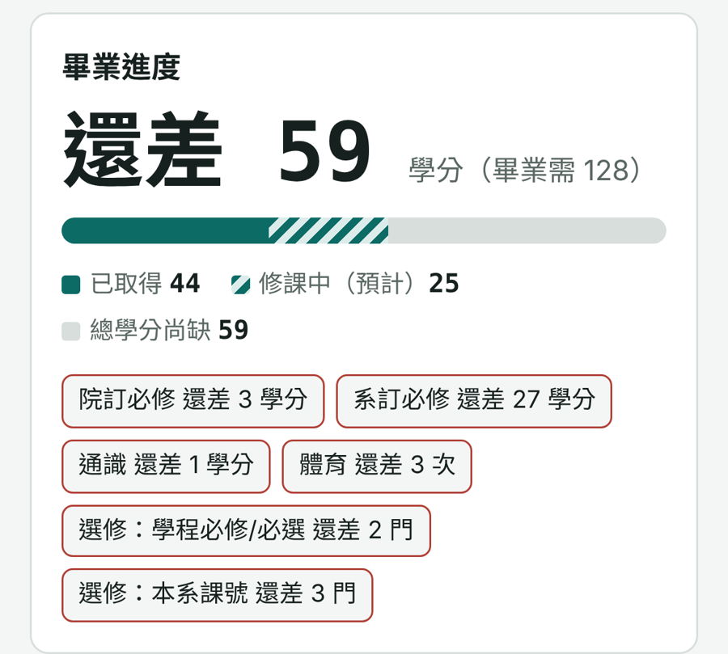
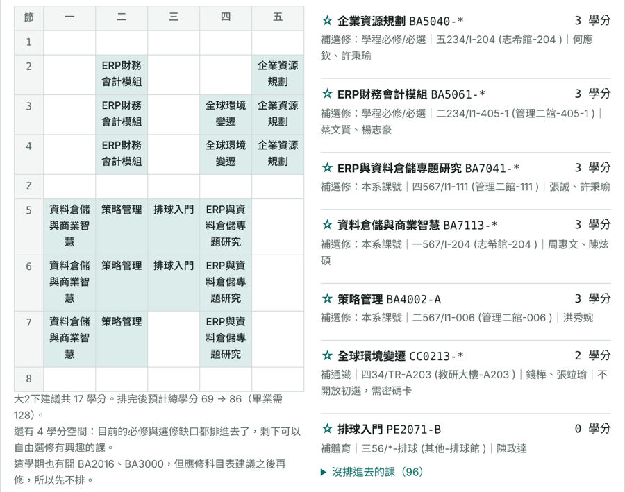

# 中大畢業學分檢核 Agent（NCU Grad Check）

> 貼上成績，檢查畢業進度，並試算下學期的修課安排。

## 專題簡介

中央大學已有「畢業審核系統」，但跨類別的學分認列（例如通識超修能抵多少選修、學分學程與系選修能否共用）系統不會算，學生只能自己翻應修科目表手算，常到大四才發現少修。本專題以可驗證的規則引擎計算學分與排課，再用 AI 以白話回答學生的問題，AI 的回答最後經過數字稽核。

目前收錄 10 個系所／組別的應修規則：企管（114）、資管（114）、財金（113）、經濟（114）、光電（114）、物理甲類與乙類（114）、化學（114）、數學計算與資料科學組（114）、數學科學組（114）。

- **AI 負責「說」**：依檢核報告回答學生的問題、用白話解釋結果
- **程式負責「算」**：成績解析與學分計算交給可驗證的規則引擎，AI 的回答再經過數字稽核

## 畫面

| 畢業進度（手機） | 排課建議 |
|---|---|
|  |  |

截圖使用範例成績資料（成績為隨機產生）。

## 主要功能

| 功能 | 說明 |
|---|---|
| 成績解析 | 貼上成績查詢頁文字，或手動輸入「課號 成績」，整理成修課紀錄 |
| 畢業檢核 | 依科系規則核對必修、通識、國文、外文、體育、服務學習與選修 |
| 跨域進度 | 可選學分學程、領域專長與微學程並查看進度；已整理規則的項目會自動檢核，尚未整理者會標示待補。這些進度獨立顯示，不影響畢業總學分 |
| 抵免試算 | 選擇已及格來源課與申請抵免的正式課，可加入或移除試算；結果標示待審核，不增加畢業總學分。企管支援電子商務抵免試算；微學程不判斷科系資格 |
| 系辦確認提醒 | 依所選學程、領域專長、微學程與抵免項目顯示相關提醒 |
| 解析錯誤明細 | 將無法辨識的成績內容列在解析提示下方 |
| 試算 | 詢問加入課程後的進度，例如「如果我修 BA5040、BA7114 會怎樣？」 |
| 排課建議 | 選擇要排的年級學期（大一上至大四下），從內建或手動貼上的開課資料挑課；依未修必修、擇N、選修、通識、體育與學程缺口挑課，避開衝堂並逐門重算缺口。可加星號優先排想修的課、勾選加排全民國防教育 |
| 排課設定 | 可設定正整數學分上限，沒有固定最高值；設定保存在瀏覽器本機 |
| 微學程規則版本 | 「智慧永續生活」與「智慧數據分析與應用」可分別設定申請時間，並套用對應課程版本；已補入 GS4519、GS4538 等課號及等同課號避免重複計算 |
| 數字稽核 | 標示 AI 回答中無法在檢核報告找到的數字，提醒人工確認 |
| 防呆 | 若無法解析任何修課紀錄，停止檢核，避免產生錯誤結論 |

## 網頁版

- 網頁：[中大畢業學分檢核](https://steven20070308-art.github.io/ncu-grad-check/)。GitHub Pages 需設定為使用 `main` 分支的 `/docs` 資料夾。
- 選擇科系與入學年度，貼上成績頁或輸入修課紀錄，即可查看逐項檢核、學程進度與試算結果。
- 成績解析與學分計算都在瀏覽器內進行。使用「問 AI」時，只傳送檢核摘要，不傳送原始成績。
- 網頁會依使用環境選擇 AI：在 Claude 中開啟時可使用 Claude；其他情況使用已設定的 Gemini 中繼站，或改貼自己的 Gemini API 金鑰。金鑰只保存在該瀏覽器的 `localStorage`，由瀏覽器直接呼叫 Google。中繼站金鑰存於 Cloudflare Secret，並限制來源網站與每個 IP 的每日呼叫次數，詳見 [`worker/README.md`](worker/README.md)。
- 有產生排課建議時，網頁會將該建議附給 AI，讓回答依照試算課表說明。
- 排課使用內建的 115-1 開課資料（示範用）；要用其他學期，在「更新開課資料」貼上課程查詢頁的內容即可。網頁不會直接連線選課系統。
- 網頁核心邏輯 `web/gradcheck.js` 與 Python 規則引擎可用 `node web/test_parity.js` 逐項比對畢業檢核與學分學程結果（下表網頁版獨有的功能不在比對範圍內）。

### 網頁版與 Python CLI 的功能差異

兩者共用同一套 `rules/*.json` 與相同的畢業檢核邏輯，但部分功能只做在網頁版：

| 功能 | 網頁版 | Python CLI（`agent.py`） |
|---|---|---|
| 畢業檢核（必修、選修、通識、外文、體育等） | ✓ | ✓ |
| 學分學程進度（`rules/programs_114.json`） | ✓ | ✓（`--track` 指定） |
| 領域專長與微學程進度（`rules/modules_115.json`） | ✓ | 不支援 |
| 抵免試算（微學程、企管電子商務） | ✓ | 不支援 |
| 排課建議 | ✓ | 不支援 |
| 「如果再修這些課」試算 | ✓ | ✓（問題含課號時自動試算） |
| 問 AI 與數字稽核 | ✓ | ✓ |

要在 Python 版使用上述網頁獨有的功能，需先把 `web/gradcheck.js` 對應的邏輯移植到 `engine.py`，並在 `web/test_parity.js` 加入比對。

## 系統流程

```text
貼上成績文字
   │
   ▼
① 解析修課紀錄（讀不到任何課程就停止）
   │
   ▼
② 依問題路由：含課號時試算，否則解釋進度
   │
   ▼
③ engine.py 依規則計算，不使用 AI 計算學分
   │
   ▼
④ AI 將檢核報告整理成白話說明
   │
   ▼
⑤ 稽核回答中的數字，再回覆使用者
```

## 使用技術與規則來源

| 層面 | 技術 |
|---|---|
| 規則引擎（CLI） | Python 3（只用標準函式庫）：`engine.py`、`agent.py` |
| 網頁 | 原生 HTML／CSS／JavaScript 單頁網頁，所有計算在瀏覽器內完成；`web/build.py` 把規則、程式與開課資料打包成 `docs/index.html` |
| 部署 | GitHub Pages（`main` 分支 `/docs`） |
| AI（網頁） | Google Gemini（主模型忙碌時自動換備援模型）；透過 Cloudflare Workers 中繼站保管金鑰，或使用者自備金鑰；在 Claude 中開啟時改用 Claude |
| AI（CLI） | OpenAI 相容 API，可設定 Google Gemini、Azure OpenAI、OpenAI 或本機 Ollama |
| 可信度 | 規則引擎計算、AI 只負責說明；數字稽核；AI 無法使用時檢核與排課照常運作 |
| 測試 | `test_agent.py`（解析、路由、稽核、及格判定）；`web/test_parity.js`（Python 與網頁版逐項比對，目前 1,215 項） |
- 規則來源包括各系應修科目表，以及中央大學公告的學分學程、領域專長與微學程資料；來源連結收錄在 `rules/*.json`。

## 安裝與執行

```bash
git clone https://github.com/steven20070308-art/ncu-grad-check.git
cd ncu-grad-check

# 執行解析、路由與稽核測試
python test_agent.py

# 離線執行，不需要 API 金鑰
python agent.py --paste data/sample_paste.txt --ask "我還差多少學分？" --mock

# 使用預設企管 114 規則連接 AI
# 複製 .env.example 為 .env，填入 Gemini API 金鑰
python agent.py --paste data/sample_paste.txt --ask "我還差多少學分？"

# 指定其他科系規則，例如資管 114
python agent.py --rules rules/im_114.json --paste data/sample_paste.txt --ask "我還差多少學分？" --mock
```

### 網頁版（開發）

需要 Python 3 與 Node.js。

```bash
# 修改 rules/、web/ 或 data/ 後，重新產生 docs/index.html
python web/build.py

# 比對 Python 與網頁版的檢核結果
node web/test_parity.js

# 用瀏覽器直接開啟本機檔案預覽
# Windows：start docs/index.html　macOS：open docs/index.html
```

推送到 GitHub 後，GitHub Pages 會自動更新網站。選用的 AI 中繼站部署步驟見 [`worker/README.md`](worker/README.md)。

`.env` 已列入 `.gitignore`，請勿將 API 金鑰提交到 GitHub。Python CLI 預設使用 `rules/ba_114.json`；其他科系可用 `--rules` 指定規則檔。更多 AI 連線設定請參考 [`.env.example`](.env.example)。

## 操作流程

### 網頁版（一般使用者）

1. 用手機或電腦打開 <https://steven20070308-art.github.io/ncu-grad-check/>。
2. **選科系**：選擇自己的科系與入學年度。
3. **貼上成績**：登入中大成績查詢頁，在表格內點一下後按 `Ctrl+A`、`Ctrl+C`，回到網頁貼上，按「開始檢核」。想先試用可以按「載入範例」。
4. **勾選學程**：有修學分學程、領域專長或微學程的話勾選，需要時可加入抵免試算。
5. **看檢核結果**：最上方顯示還差幾學分；「逐項核對」列出每一項的進度，紅色標籤是還沒完成的項目。
6. **排課建議**：選要排的學期與學分上限，按「產生排課建議」。想修的課可以加星號優先排，也可以勾選加排全民國防教育。
7. **問 AI**：在「問 AI」輸入問題，例如「我還差多少學分？下學期怎麼修比較好？」。回答下方會顯示數字稽核結果。
8. 「需要向系辦確認」列出程式無法判斷的事項；最終結果以系辦審核為準。

### Python CLI

1. 登入中大成績查詢頁，在表格內點一下後按 `Ctrl+A`、`Ctrl+C`。
2. 將內容存成文字檔，例如 `data/my_paste_private.txt`；檔名包含 `private` 的檔案會被 `.gitignore` 排除。
3. 執行 `python agent.py --paste data/my_paste_private.txt --ask "你的問題"`。
4. 查看解析到的課程、使用的路由、AI 回答與數字稽核結果。

## 專案檔案

| 路徑 | 用途 |
|---|---|
| `agent.py` | CLI Agent：解析成績、路由問題、呼叫 AI 並稽核回答 |
| `engine.py` | Python 規則引擎：計算畢業學分及學程進度 |
| `rules/*.json` | 各科系、學分學程與領域專長／微學程規則 |
| `rules/src/` | 科學院規則來源資料與產生程式 |
| `data/sample_*` | 範例成績資料；課程清單為真實資料，成績為隨機產生 |
| `data/offerings_*.txt` | 115-1 學期課程查詢資料，供網頁排課建議使用 |
| `web/gradcheck.js` | 網頁版解析、檢核、試算與排課邏輯 |
| `web/template.html` | 網頁介面模板 |
| `web/build.py` | 將規則、程式與範例資料組合成 `docs/index.html` |
| `web/test_parity.js` | 比對 Python 與網頁版檢核結果 |
| `docs/index.html` | GitHub Pages 使用的單頁網頁 |
| `docs/img/` | README 使用的畫面截圖 |
| `worker/gemini-proxy.js` | 選用的 Cloudflare Workers Gemini 中繼站 |
| `test_agent.py` | CLI Agent 的解析、稽核與路由測試 |

## 限制

- 目前畢業規則涵蓋 10 個系所／組別；其他系所需整理應修科目表後新增規則檔。
- 部分學分學程、領域專長與微學程尚未整理成可自動檢核的完整規則，網頁會標示待確認項目。
- 領域專長、微學程與抵免試算目前只有網頁版支援，Python CLI 尚未支援（見「網頁版與 Python CLI 的功能差異」）。
- 通識核心四領域的歸屬資料尚未取得。
- 同一門課可否同時認列系選修與學分學程、不同學程間的重疊課程能否重複認列，仍需向系辦確認；程式目前依規則設定處理。
- 本工具僅供參考，最終結果以系辦與註冊組審核為準。

## 相關文件

- 提案簡報（Microsoft × NCU AI 創新應用主題挑戰賽）：[待上傳 PDF]
- AI 協作歷程報告：[待上傳 PDF]

## 作者與分工

| 成員 | 主要貢獻 |
|---|---|
| 企管 2A 張育晨 | 初版與主要功能：規則引擎、AI Agent 與數字稽核、網頁版、排課建議、10 系所規則、AI 中繼站 |
| 企管 2B 林宥欣 | 領域專長與微學程規則、抵免試算、介面調整、README |
| 企管 2B 廖健崴 | 物理系規則與開課資料整理 |

各成員的修改紀錄可在 [Commits](https://github.com/steven20070308-art/ncu-grad-check/commits/main) 查看。
